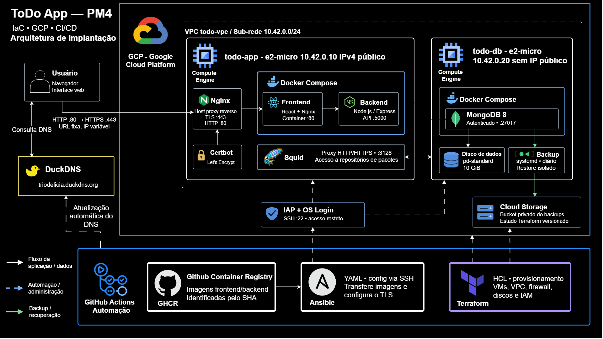

# ToDo App — PM4

**Infraestrutura como Código, Google Cloud Platform e CI/CD**

Projeto Mensal 4 do 8º período de Engenharia de Software da UniAmérica.

## Grupo Triodelicia

- [@pepepedrinho](https://github.com/pepepedrinho) — Pedro Henrique Alves dos Santos
- [@G4rb1n](https://github.com/G4rb1n) — Lipe
- [@Eduol4](https://github.com/Eduol4) — Eduardo

## Sobre o projeto

O projeto consiste na implantação de uma aplicação de gerenciamento de tarefas na Google Cloud Platform, utilizando infraestrutura como código e automação dos processos de configuração, implantação e operação.

Partimos da [aplicação disponibilizada pelo professor](https://github.com/LaercioMLB/todo-app), desenvolvida com React, Node.js e MongoDB, e adaptamos sua execução para um ambiente em nuvem.

O principal objetivo foi automatizar a criação e configuração da infraestrutura, desde o provisionamento das máquinas virtuais até a publicação da aplicação, incluindo mecanismos de segurança, persistência, backup e recuperação dos dados.

**Endereço da aplicação:** https://triodelicia.duckdns.org

A infraestrutura permanece desligada fora dos períodos de utilização para reduzir os custos.

## Arquitetura



A infraestrutura é composta por duas máquinas virtuais Compute Engine na região `us-central1`, zona `us-central1-a`.

| Instância | Configuração | IP privado | Função |
| --- | --- | --- | --- |
| `todo-app` | e2-micro | 10.42.0.10 | Frontend, backend e acesso público |
| `todo-db` | e2-micro | 10.42.0.20 | MongoDB e backup dos dados |

As duas instâncias estão na mesma VPC, mas apenas a máquina da aplicação possui um IP público.

O acesso externo é realizado pelo domínio DuckDNS, utilizando HTTPS. O Nginx instalado na VM recebe as requisições e as encaminha para a aplicação executada em containers Docker.

O frontend utiliza React servido pelo Nginx, que também encaminha as requisições da API ao backend Node.js/Express. A comunicação entre o backend e o MongoDB acontece exclusivamente pela rede privada.

O MongoDB utiliza um disco persistente dedicado, permitindo que os dados sejam preservados após reinicializações e atualizações dos containers.

## Tecnologias utilizadas

| Tecnologia | Utilização |
| --- | --- |
| Google Cloud Platform | Hospedagem da infraestrutura |
| Compute Engine | Execução das máquinas virtuais |
| Terraform | Provisionamento da infraestrutura |
| Ansible | Configuração das máquinas e implantação |
| Docker | Empacotamento e execução da aplicação |
| Docker Compose | Gerenciamento dos containers |
| GitHub Actions | Automação dos pipelines |
| GitHub Container Registry | Armazenamento das imagens Docker |
| React | Interface da aplicação |
| Node.js / Express | API |
| MongoDB | Banco de dados |
| Nginx | Servidor web e proxy reverso |
| DuckDNS | Resolução do domínio |
| Certbot / Let's Encrypt | Certificados HTTPS |
| Squid | Proxy de acesso a repositórios de pacotes |
| Cloud Storage | Estado do Terraform e backups |

## Infraestrutura como código

### Terraform

O Terraform é responsável pelo provisionamento dos recursos utilizados na GCP.

As configurações estão divididas em duas partes:

- [`bootstrap`](infra/terraform/bootstrap/): configuração inicial das APIs, permissões, contas de serviço, autenticação, buckets e orçamento.
- [`main`](infra/terraform/main/): criação das máquinas virtuais, rede, sub-rede, firewall e discos.

Antes de aplicar uma alteração, o Terraform gera um plano com os recursos que serão criados, modificados ou removidos.

O estado da infraestrutura é armazenado em um bucket privado do Google Cloud Storage, permitindo que diferentes execuções dos pipelines utilizem o mesmo ambiente.

### Ansible

Após o provisionamento, o Ansible acessa as máquinas virtuais e realiza as configurações necessárias para a execução da aplicação.

Entre suas responsabilidades estão:

- Instalação do Docker e demais dependências.
- Configuração do Nginx, Certbot e Squid.
- Preparação e montagem do disco persistente.
- Configuração do MongoDB e suas credenciais.
- Implantação dos containers.
- Configuração dos serviços de backup.

O playbook principal está disponível em [`infra/ansible/site.yml`](infra/ansible/site.yml).

A configuração foi executada duas vezes durante os testes para verificar sua idempotência, garantindo que uma nova execução não realize alterações desnecessárias em um ambiente já configurado.

## CI/CD

A automação do projeto é realizada pelo GitHub Actions. Os pipelines são responsáveis pela validação do código, construção das imagens Docker, provisionamento da infraestrutura, implantação e operação do ambiente.

| Workflow | Responsabilidade |
| --- | --- |
| Validate | Testes da aplicação e validação das configurações de infraestrutura |
| Publish images | Construção e publicação das imagens no GHCR |
| Infrastructure | Validação, planejamento e provisionamento com Terraform |
| Configure and deploy | Configuração das VMs com Ansible, implantação e testes |
| Operate | Inicialização, desligamento, diagnóstico, backup, restauração e rollback |
| Decommission infrastructure | Desativação da infraestrutura com preservação controlada dos dados |

As imagens do frontend e do backend são identificadas pelo SHA do commit correspondente, permitindo selecionar versões específicas durante a implantação e o rollback.

Os workflows que realizam operações na GCP são acionados manualmente para evitar a inicialização desnecessária das máquinas e controlar os custos.

As definições dos pipelines estão disponíveis em [`.github/workflows/`](.github/workflows/).

## Segurança e comunicação

A infraestrutura utiliza uma VPC própria, com regras de firewall que restringem a comunicação entre os recursos.

O MongoDB não possui IP público e sua porta de comunicação está restrita à VM da aplicação.

O acesso administrativo às máquinas é realizado por meio do IAP e do OS Login, sem exposição pública da porta SSH.

A autenticação dos pipelines na GCP utiliza OIDC e credenciais temporárias. As senhas e os tokens necessários à operação são armazenados em GitHub Secrets e não fazem parte do código-fonte.

Como a VM do banco não possui acesso direto à internet, utilizamos o Squid na VM da aplicação como proxy restrito para instalação de pacotes e dependências.

O acesso aos serviços do Google Cloud, como o Cloud Storage, é realizado por meio do Private Google Access.

### Domínio e HTTPS

O domínio `triodelicia.duckdns.org` é atualizado automaticamente durante a inicialização do ambiente.

Dessa forma, podemos utilizar um IP público efêmero sem precisar alterar o endereço de acesso à aplicação a cada reinicialização.

O certificado HTTPS é emitido pelo Let's Encrypt e gerenciado pelo Certbot.

## Persistência, backup e recuperação

Os dados do MongoDB são armazenados em um disco persistente exclusivo de 10 GiB.

Além da persistência local, utilizamos um bucket privado do Google Cloud Storage para armazenar os backups do banco de dados.

O backup é automatizado por um serviço e um timer do systemd. A restauração é testada em um ambiente isolado, sem sobrescrever os dados da aplicação.

Também foi implementado um procedimento de rollback que permite retornar à versão anterior das imagens Docker, preservando os dados existentes.

Os backups agendados dependem de a VM do banco estar em execução.

## Evolução do projeto

As branches numeradas representam as principais etapas de desenvolvimento e implantação.

| Branch | Etapa |
| --- | --- |
| `00-base-professor` | Aplicação original disponibilizada pelo professor |
| `01-aplicacao-containers` | Adaptação da aplicação, Docker Compose e testes locais |
| `02-infraestrutura-e-cicd` | Terraform, Ansible e pipelines |
| `03-implantacao-gcp` | Implantação na GCP, segurança e publicação HTTPS |
| `04-operacao-e-recuperacao` | Backup, restauração, rollback e operação |
| `05-entrega-final` | Versão final do projeto |
| `main` | Versão consolidada |

## Estrutura do repositório

```text
.
├── backend/
├── frontend/
├── banco-de-dados/
├── infra/
│   ├── terraform/
│   ├── ansible/
│   └── controller/
├── .github/
│   └── workflows/
├── scripts/
├── docs/
│   ├── imagens/
│   └── evidencias/
├── docker-compose.yaml
└── README.md
```

## Execução local

Para executar a aplicação localmente, é necessário possuir Git, Python 3, Docker e Docker Compose v2.

Clone o repositório:

```bash
git clone https://github.com/pepepedrinho/S8_GCP_IaC_CICD_ToDoApp.git
cd S8_GCP_IaC_CICD_ToDoApp
```

Prepare as configurações locais:

```bash
python scripts/init-local.py
```

Construa as imagens e inicialize os containers:

```bash
docker compose -p todo-implementation up --build -d --wait --wait-timeout 180
```

Verifique o funcionamento da aplicação:

```bash
python scripts/smoke.py http://127.0.0.1:8080
```

A aplicação estará disponível em:

http://127.0.0.1:8080

Para desligar os containers sem remover os dados:

```bash
docker compose -p todo-implementation stop
```

## Execução na GCP

Como a infraestrutura já está provisionada, não é necessário executar novamente o Terraform ou reconstruir as imagens para acessar a aplicação.

### Inicialização

1. Acesse a aba Actions do repositório.
2. Selecione o workflow [Operate](https://github.com/pepepedrinho/S8_GCP_IaC_CICD_ToDoApp/actions/workflows/operate.yml).
3. Clique em Run workflow.
4. Selecione a branch `main` e a operação `start`.
5. Aguarde a conclusão do workflow.

A aplicação pode então ser acessada em:

https://triodelicia.duckdns.org

Também é possível iniciar o ambiente pelo GitHub CLI:

```bash
gh workflow run operate.yml -R pepepedrinho/S8_GCP_IaC_CICD_ToDoApp --ref main -f operation=start
```

### Desligamento

Para desligar a infraestrutura, utilize o mesmo workflow selecionando a operação `stop` ou execute:

```bash
gh workflow run operate.yml -R pepepedrinho/S8_GCP_IaC_CICD_ToDoApp --ref main -f operation=stop
```

Cada VM possui um limite de seis horas de execução por inicialização, após o qual será desligada automaticamente.

Os discos, backups e demais configurações são preservados para utilizações posteriores.

## Testes e validações

Durante o desenvolvimento, foram realizadas validações locais, nos pipelines e diretamente no ambiente da GCP.

| Validação | Resultado |
| --- | --- |
| Execução local com Docker Compose | Aprovado |
| Validação das configurações Terraform | Aprovado |
| Validação dos playbooks Ansible | Aprovado |
| Idempotência do Ansible | Aprovado |
| Provisionamento das máquinas virtuais | Aprovado |
| Isolamento do MongoDB | Aprovado |
| Publicação HTTPS | Aprovado |
| Renovação do certificado | Aprovado |
| CRUD pelo navegador | Aprovado |
| Persistência após reinicialização | Aprovado |
| Persistência após recriação do container | Aprovado |
| Backup no Cloud Storage | Aprovado |
| Restauração isolada | Aprovado |
| Atualização e rollback | Aprovado |
| Reativação do ambiente | Aprovado |

Também foi realizado um teste de carga com 100 requisições e 10 conexões simultâneas, sem erros e com latência p95 de 381 ms. O resultado corresponde a um teste de curta duração, não a uma avaliação de capacidade sustentada.

Os testes de rollback utilizaram imagens distintas da mesma base funcional, sem migração de schema.

Os resultados completos e suas evidências estão disponíveis na [matriz de aceite](docs/matriz-aceite.md) e no [relatório de entrega](docs/relatorio-entrega.md).

## Custos e limitações

A arquitetura foi dimensionada para atender aos requisitos do projeto com baixo custo, utilizando duas instâncias e2-micro e evitando a contratação de serviços adicionais, como Cloud NAT, balanceadores gerenciados e bancos de dados gerenciados.

Durante a implantação e os testes, o custo acumulado estimado foi de US$ 1,63. Esse valor é uma estimativa, não o total efetivamente faturado.

Mesmo com as máquinas desligadas, os discos persistentes e os buckets podem continuar gerando cobranças.

A solução não possui alta disponibilidade entre máquinas ou zonas. Foi dimensionada para uma aplicação acadêmica de pequeno porte e utilização eventual.

Mais informações estão disponíveis na [documentação de custos](docs/custos.md).

## Documentação complementar

- [Escopo do projeto](docs/escopo.md)
- [Manual de operação](docs/manual-operacao.md)
- [Segurança da infraestrutura](docs/seguranca-bootstrap.md)
- [Matriz de aceite](docs/matriz-aceite.md)
- [Relatório de entrega](docs/relatorio-entrega.md)
- [Estimativa de custos](docs/custos.md)
- [Evidências dos testes](docs/evidencias/README.md)
