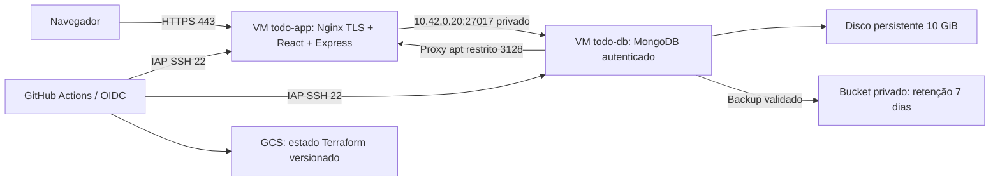

# ToDo App — Terraform, Ansible e GitHub Actions na GCP

Projeto acadêmico baseado no [código do professor](https://github.com/LaercioMLB/todo-app). Cadastrar, listar, concluir, reabrir e excluir tarefas continuam sendo as únicas funções de negócio. A lista é compartilhada, sem login. O cenário de feira está no [escopo original](docs/escopo.md); o usuário confirmou que esta entrega é um trabalho de faculdade, sem evento real.

**Estado da entrega:** aplicação, persistência, backup, restauração isolada e rollback testados localmente e pela [CI real](https://github.com/pepepedrinho/S8_GCP_IaC_CICD_ToDoApp/actions/runs/45225218488), com imagens publicadas no GHCR. Infraestrutura e playbooks implementados; implantação GCP depende da aprovação adicional descrita em [segurança do bootstrap](docs/seguranca-bootstrap.md). Nenhuma URL pública foi emitida. Consulte a [matriz de aceite](docs/matriz-aceite.md), o [progresso](docs/progresso-implementacao.md) e o [relatório](docs/relatorio-entrega.md) para distinguir código implementado de operação comprovada.

## Arquitetura



Planejadas duas `e2-micro`, `us-central1-a`, discos `pd-standard` totalizando 30 GiB. A aplicação tem IPv4 efêmero; o banco não tem IP público. SSH somente por IAP/OS Login. Não há NAT gerenciado, balanceador ou Kubernetes. O host público baixa imagens; Ansible transfere o Mongo por SSH ao host privado. O proxy Squid só permite ao banco acessar repositórios Ubuntu/Canonical.

Cada VM tem `max_run_duration = 21600`, ação `STOP` e reinício automático desabilitado. Esse limite recomeça a cada inicialização. O deploy autônomo também desliga ambas explicitamente ao terminar. A [estimativa de custos](docs/custos.md) considera franquias compartilhadas e armazenamento que permanece após desligar.

## Executar localmente

Pré-requisitos: Docker Desktop com contêineres Linux e Compose v2, Python 3 e Git. Node 24 é necessário para testes fora do Docker. `scripts/install-tools.ps1` instala Node e Terraform portáteis em `.tools/`, com hashes oficiais, sem alterar o PATH global.

```powershell
python scripts/init-local.py
docker compose -p todo-implementation up --build -d --wait --wait-timeout 180
python scripts/smoke.py http://127.0.0.1:8080
```

Abra **http://127.0.0.1:8080**. Somente essa porta é publicada, restrita ao computador local. Frontend e API usam a mesma origem; Mongo e API não publicam portas locais. Senhas aleatórias são geradas uma única vez em `.local/secrets/`, ignorada pelo Git. O volume nomeado preserva tarefas; os dados iniciais entram somente na primeira inicialização do volume.

```powershell
docker compose -p todo-implementation ps
docker compose -p todo-implementation logs --tail 100 backend
docker compose -p todo-implementation stop
```

Use sempre o mesmo nome de projeto Compose para reencontrar seu volume. `down` preserva o volume; **`down -v` apaga os dados**. Não use a remoção de volumes como rotina de desligamento.

## Testes

```powershell
cd backend
npm ci
npm test
cd ../frontend
npm ci
npm test
npm run build
cd ..
python scripts/integration.py
python scripts/test-release.py
```

Os dois scripts de integração usam o projeto `todo-implementation` por padrão; defina `COMPOSE_PROJECT_NAME` se usar outro. Exercitam Mongo real, persistência, indisponibilidade do banco, atualização, rollback manual e recuperação de imagem defeituosa. Os testes de release usam a mesma fonte da aplicação em duas imagens com configurações/versionamento distintos; não testam migração de schema.

Backup local com Bash, mantendo o Compose em execução:

```bash
export COMPOSE_PROJECT_NAME=todo-implementation
export TODO_ROOT="$PWD/.local" COMPOSE_FILE="$PWD/docker-compose.yaml" MONGO_IMAGE=todo-mongo:local
bash scripts/backup.sh
```

No Git Bash do Windows, use `COMPOSE_FILE="$(pwd -W)/docker-compose.yaml"` e `MSYS_NO_PATHCONV=1`. O backup é validado automaticamente em outro volume e contêiner **sem rede**. O Mongo principal é parado temporariamente para caber na memória de uma `e2-micro`, e reiniciado por `trap`, inclusive em falha. A restauração nunca monta o volume principal. Arquivos ficam em `.local/backups/`; não os publique.

## Infraestrutura e pipelines

`infra/terraform/bootstrap/` define APIs, dois buckets protegidos, IAM restrito, três contas de serviço, OIDC e alerta de orçamento. `infra/terraform/main/` define apenas rede, firewalls, discos e duas VMs. A separação permite criar o bucket antes de migrar o estado. `infra/ansible/` configura os hosts; não formata discos que já contenham filesystem inesperado.

O bootstrap ainda **não foi aplicado**. O faturamento foi vinculado ao projeto novo; a aprovação automática bloqueou as alterações persistentes de IAM/OIDC. Não execute o bootstrap antes da autorização adicional. Após aprovação, `python scripts/terraform-plan.py bootstrap` produz o plano revisável e `python scripts/bootstrap.py` aplica o plano e migra o estado. Esses scripts usam a sessão do proprietário, sem salvar token. O estado de bootstrap fica em `todo/bootstrap`; os pipelines só acessam `todo/main`.

| Workflow | Acionamento | Resultado |
| --- | --- | --- |
| Validate (`ci.yml`) | Push/PR | Testes, auditoria npm, Terraform, Ansible, integração e backup reais |
| Publish images (`images.yml`) | CI aprovada em push ou manual | Frontend/backend GHCR identificados pelo SHA do commit |
| Infrastructure (`infra.yml`) | Manual; `apply` exige `PROVISION` | Plano com allowlist e provisionamento explícito |
| Configure and deploy (`deploy.yml`) | Manual; SHA completo | Imagens no host, Ansible, HTTPS, CRUD/carga/backup e desligamento final |
| Operate (`operate.yml`) | Manual | Iniciar, parar, saúde, logs, backup, restore isolado e rollback |
| Decommission (`destroy.yml`) | Manual; `DESTROY-TODO` | Backup final validado antes de remover a infraestrutura principal |

Push comum **não cria VMs**. Os workflows de nuvem compartilham um grupo de concorrência. O [manual de operação](docs/manual-operacao.md) explica pré-requisitos, variáveis/secrets, parâmetros, resultados esperados e recuperação. Publicar a branch não equivale a validar provisionamento, OIDC ou execução remota.

## Documentação e evidências

- [Escopo do professor](escopo.pdf) e [versão textual](docs/escopo.md).
- [Matriz REQ/ACE](docs/matriz-aceite.md), [evidências](docs/evidencias/) e [progresso](docs/progresso-implementacao.md).
- [Manual de operação](docs/manual-operacao.md), [custos](docs/custos.md) e [permissões do bootstrap](docs/seguranca-bootstrap.md).
- [Relatório da entrega e pendências](docs/relatorio-entrega.md).

Limitações: capacidade das VMs ainda não medida; HTTPS/renovação e idempotência remota ainda não executados; DNS gratuito depende de terceiros e a URL muda com o IPv4 efêmero. Não há autenticação de usuários, alta disponibilidade ou sincronização automática entre navegadores. A demonstração pelos alunos continua sendo uma etapa humana de aceite.
