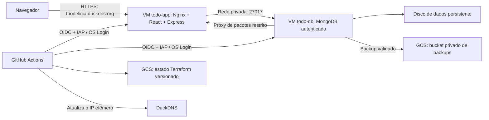

# ToDo App — GCP, Terraform, Ansible e CI/CD

Projeto acadêmico de implantação e operação de uma aplicação web na Google Cloud Platform. Partimos do [ToDo App disponibilizado pelo professor](https://github.com/LaercioMLB/todo-app) e automatizamos infraestrutura, configuração, entrega e recuperação dos dados.

**Endereço:** [triodelicia.duckdns.org](https://triodelicia.duckdns.org). A aplicação fica disponível quando a infraestrutura está em execução. Fora dos períodos de utilização, mantemos as duas VMs desligadas para reduzir custos; discos e backups permanecem armazenados.

## Aplicação e requisitos

O sistema permite cadastrar, listar, concluir, reabrir e excluir tarefas. A lista é compartilhada e usa apenas dados de demonstração, sem login ou separação por pessoa. Frontend e API são publicados na mesma origem HTTPS.

O [escopo acadêmico](docs/escopo.md) exige aplicação e MongoDB em servidores distintos, banco acessível somente pela rede privada, administração restrita, persistência, backup com restauração testada e operação por pipelines. A feira descrita no enunciado é o cenário de referência; não há evento real agendado.

| Camada | Tecnologias |
| --- | --- |
| Aplicação | React, Vite, Nginx, Node.js e Express |
| Banco e execução | MongoDB, Docker e Docker Compose |
| Infraestrutura | Compute Engine, VPC, IAP, OS Login, IAM e Cloud Storage |
| Automação | Terraform, Ansible, GitHub Actions e GHCR |
| Publicação e operação | DuckDNS, Let's Encrypt/Certbot, systemd, Bash e Python |

## Arquitetura



O ambiente utiliza duas **e2-micro em us-central1-a**: `todo-app` (10.42.0.10) e `todo-db` (10.42.0.20). Apenas a aplicação recebe IPv4 público efêmero. São três discos `pd-standard` de 10 GiB, incluindo um disco exclusivo para os dados do MongoDB. Não há balanceador, Cloud NAT gerenciado, Cloud SQL ou GKE.

A administração usa IAP e OS Login. O firewall aceita MongoDB somente a partir da aplicação e o proxy de pacotes somente a partir do banco. Cada VM possui limite nativo de **seis horas por inicialização**, ação `STOP` e reinício automático desabilitado.

## Evolução e branches

As branches numeradas são marcos cumulativos do histórico real. Terraform, Ansible e os workflows foram introduzidos juntos e compõem um único marco.

| Branch | Marco |
| --- | --- |
| `00-base-professor` | Código e histórico originais do professor, sem adaptações |
| `01-aplicacao-containers` | Aplicação adaptada, Compose privado, persistência e testes locais |
| `02-infraestrutura-e-cicd` | Terraform, Ansible, pipelines, GHCR e preparação da integração |
| `03-implantacao-gcp` | Provisionamento real, transporte IAP, MongoDB e integração DuckDNS |
| `04-operacao-e-recuperacao` | Correções operacionais de backup, rollback, recuperação e reativação |
| `05-entrega-final` | Evidências consolidadas, organização e documentação da entrega |
| `main` | Versão consolidada, com o mesmo conteúdo de `05-entrega-final` |

As mensagens dos 30 commits da implementação foram traduzidas para português, preservando conteúdo, autoria e datas. Os commits originais do professor permanecem intactos. O [registro da reorganização](docs/reorganizacao-repositorio.md) documenta os marcos e a correspondência entre hashes antigos e novos. Tags GHCR e evidências de testes anteriores mantêm seus identificadores originais.

## Organização do repositório

```text
backend/                  API Express e testes
frontend/                 Interface React, Nginx e testes
banco-de-dados/            Imagem, inicialização e sondas MongoDB
infra/terraform/           Bootstrap e infraestrutura principal
infra/ansible/             Playbooks, roles e transporte IAP
infra/controller/          Controlador Linux para automação
.github/workflows/         CI, imagens, infraestrutura, deploy e operação
scripts/                   Operação, validação, backup e recuperação
docs/                      Manual, arquitetura, custos e matriz de aceite
docs/evidencias/            Resultados sanitizados e registros históricos
docs/historico/             Correspondência do histórico Git reescrito
docker-compose.yaml        Ambiente local
```

## Infraestrutura e entrega

O módulo Terraform `bootstrap` define APIs, IAM limitado, OIDC, buckets privados e alerta de orçamento. O módulo `main` define rede, firewalls, discos e duas VMs. O estado remoto separa `todo/bootstrap` de `todo/main`; a automação acessa somente o prefixo principal. Os planos passam por uma allowlist antes de aplicar alterações.

Ansible prepara os dois hosts, monta o disco de dados, configura os serviços e publica o HTTPS. A segunda execução completa foi validada sem alterações nos dois hosts. O [manual](docs/manual-operacao.md) detalha parâmetros, dependências e recuperação de falhas.

| Workflow | Acionamento e função |
| --- | --- |
| **Validate** | Push na `main` e pull requests: testes, auditoria, build, validações estáticas e integração local |
| **Publish images** | Após CI aprovada na `main` ou execução manual: frontend/backend no GHCR, identificados pelo SHA |
| **Infrastructure** | Manual: validar, planejar e provisionar a topologia prevista |
| **Configure and deploy** | Manual: selecionar imagens existentes, configurar os hosts, testar HTTPS e desligar ao terminar |
| **Operate** | Manual: start, stop, saúde, logs, diagnóstico, backup, restore, rollback e aceite |
| **Decommission infrastructure** | Manual: backup final validado antes da remoção da infraestrutura principal |

**Publicar branches não implanta na GCP.** Os workflows de infraestrutura e operação aceitam apenas `workflow_dispatch` e compartilham controle de concorrência. OIDC usa credenciais temporárias; não são necessárias chaves JSON de conta de serviço.

Imagens já utilizadas nos testes continuam disponíveis sob os SHAs originais. A [compatibilidade GHCR](docs/evidencias/compatibilidade-ghcr.json) registra os quatro manifests verificados. A tradução do histórico não renomeia imagens nem transforma um novo hash em uma versão já testada na nuvem.

## Banco, segurança e recuperação

O MongoDB é autenticado, não possui IP público e armazena dados no disco dedicado. A API usa credencial própria, limitada a `readWrite` em `todo-app`. Senhas e tokens ficam em GitHub Secrets e arquivos protegidos, fora do código e das evidências. O contato ACME também é fornecido por configuração protegida, sem endereço pessoal fixo no código.

O DuckDNS mantém a URL fixa quando o IPv4 muda. A automação atualiza e verifica o DNS antes de configurar o HTTPS; Certbot reaproveita o certificado válido e oferece renovação automática. O dry-run do domínio definitivo foi aprovado.

`/health/live` verifica o processo da API; `/health/ready` exige conexão autenticada ao banco. O fluxo de diagnóstico reúne logs limitados, estado dos contêineres e memória. A indisponibilidade do MongoDB foi testada com readiness503, liveness200 e recuperação posterior.

O backup diário usa serviço/timer systemd e GCS privado com retenção mínima de sete dias. Antes do upload, a cópia é restaurada em outro volume, sem rede, e validada por hash. O restore manual baixa archive e manifest, confere checksum e executa uma nova restauração isolada. Essas operações interrompem temporariamente o banco para caber na memória da e2-micro; não sobrescrevem a produção. VMs desligadas não produzem novos backups.

Deploy e rollback usam versões identificáveis e verificam a prontidão da aplicação. As tarefas foram preservadas durante atualização e retorno à imagem anterior. Os testes usaram imagens distintas da mesma fonte funcional, com versões/configurações diferentes; não validam migração de schema.

## Execução local

Pré-requisitos: Git, Python 3 e Docker com contêineres Linux/Compose v2. Para testes fora do Docker, utilizar Node.js 24.

```bash
git clone https://github.com/pepepedrinho/S8_GCP_IaC_CICD_ToDoApp.git
cd S8_GCP_IaC_CICD_ToDoApp
python scripts/init-local.py
docker compose -p todo-implementation up --build -d --wait --wait-timeout 180
python scripts/smoke.py http://127.0.0.1:8080
```

Abra **http://127.0.0.1:8080**. Somente essa porta é publicada, restrita ao computador local. Segredos são gerados em `.local/`, ignorada pelo Git; o volume nomeado preserva os dados. Ao terminar: `docker compose -p todo-implementation stop`. A opção `down -v` apaga o volume e não faz parte do desligamento normal.

## Operação na GCP

Os workflows manuais são executados na `main`. Para reativar o ambiente existente:

```bash
gh workflow run operate.yml -R pepepedrinho/S8_GCP_IaC_CICD_ToDoApp --ref main -f operation=start
```

Acompanhe o run até sucesso antes de abrir a URL. Ao terminar, execute o mesmo comando com `-f operation=stop` e confirme ambas `TERMINATED`. Não é necessário reprovisionar ou repetir o deploy para apresentar a versão já instalada. As demais operações e os SHAs de imagem disponíveis estão no [manual de operação](docs/manual-operacao.md).

## Validações e custos

Foram comprovados **15 dos 16 itens da matriz (93,75%)**. Passaram CRUD HTTPS e navegador, isolamento, persistência, rollback, idempotência, carga curta 100/10, backup GCS, restauração isolada, reativação e renovação do certificado. O [relatório](docs/relatorio-entrega.md) distingue testes locais, CI e GCP e preserva as falhas relevantes. O ACE-10 permanece pendente do [ensaio dos alunos](docs/ensaio-alunos.md); a rotação do token DuckDNS exposto em captura também continua pendente.

Ao encerrar os testes de implantação, ambas as VMs foram confirmadas `TERMINATED`. A estimativa acumulada registrada foi de **US$1,63**, incluindo reservas, sem valor de fatura apurado. Com as VMs desligadas, os discos ainda representam cerca de **US$1,20/730h**, além dos objetos/versionamentos e operações GCS. O alerta de orçamento não bloqueia cobranças. Consulte [custos e recursos preservados](docs/custos.md) para premissas e preços.

## Documentação complementar

- [Escopo acadêmico](docs/escopo.md) e [PDF de referência](escopo.pdf).
- [Manual de operação](docs/manual-operacao.md) e [segurança do bootstrap](docs/seguranca-bootstrap.md).
- [Matriz de aceite](docs/matriz-aceite.md), [relatório de entrega](docs/relatorio-entrega.md) e [evolução técnica](docs/progresso-implementacao.md).
- [Índice de evidências](docs/evidencias/README.md), [reorganização do repositório](docs/reorganizacao-repositorio.md) e [ensaio dos alunos](docs/ensaio-alunos.md).
